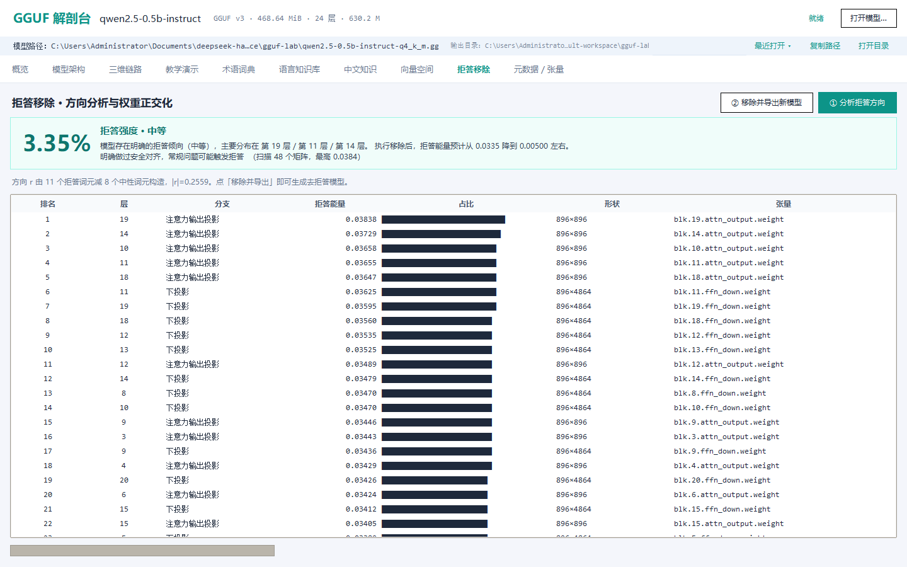
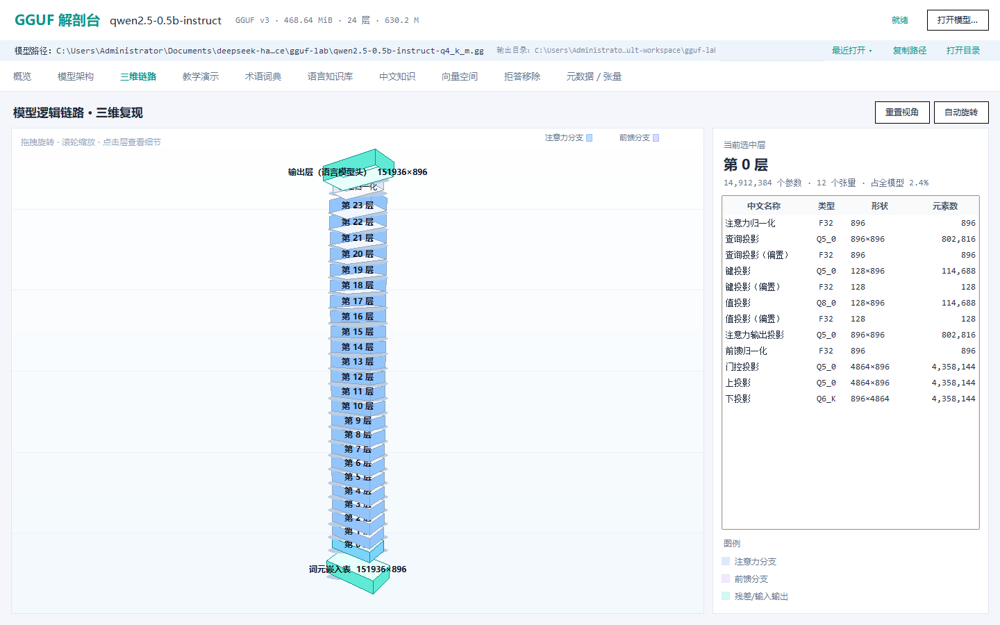
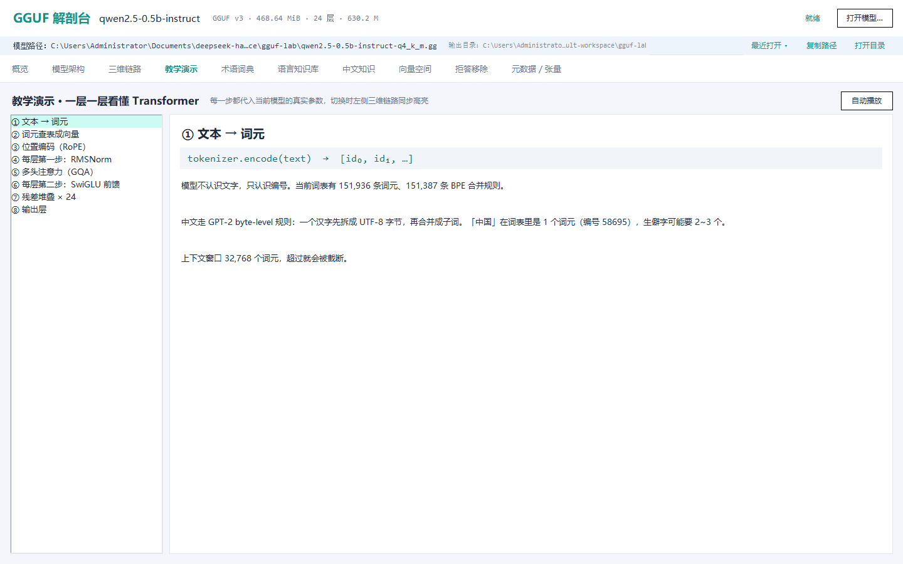
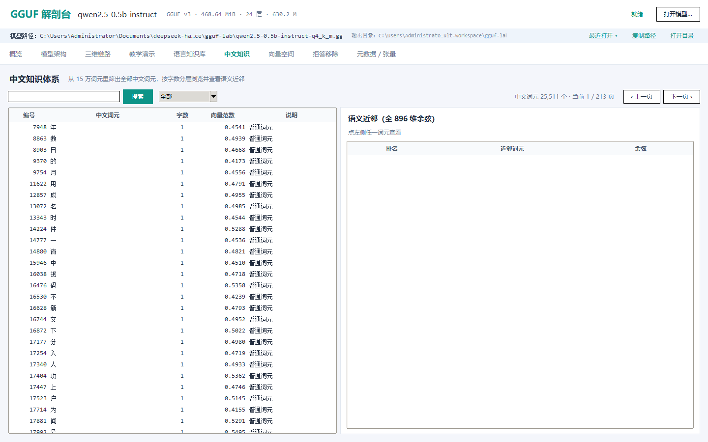

# GGUF 解剖台

把 HuggingFace 上的 `.gguf` 权重拆开看：**架构、词表、向量空间、量化块**，并把模型里的**拒答方向自动检测出来、一键移除**。全中文界面，桌面版 + 网页版双端。



## 核心能力：自动检测模型拒答

打开任意 GGUF 模型，程序在 **1 秒内自动跑完**下面五步，不需要你输入任何提示词：

1. **构造拒答方向** —— 从词元嵌入里取拒答语义词的平均向量（`sorry` / `apolog` / `cannot` / `抱歉` / `无法` / `拒绝` …），
   减去中性语义词的平均向量（`Yes` / `sure` / `当然` / `可以` / `好的` …），单位化得到 896 维方向 `r`；
2. **扫描载体矩阵** —— 所有写回残差流的线性层（注意力输出投影、前馈下投影，共 48 个），
   计算 `r` 在其中的能量占比 `‖rᵀW‖ / ‖W‖`；
3. **打分定级** —— 平均能量换算成 0~100 的「拒答强度」，分五档：极弱 / 偏弱 / 中等 / 偏强 / 很强；
4. **定位责任层** —— 按层聚合能量，列出贡献最大的 5 层；
5. **给出移除预期** —— 正交化之后残差预计降到多少。

本机实测（Qwen2.5-0.5B-Instruct q4_k_m）：

```
拒答强度   3.35%          评分 33.5 / 100        等级：中等
扫描矩阵   48 个          平均能量 0.03351       最高 0.03838
责任层     第 19 / 11 / 14 / 18 / 10 层
移除结果   0.03351 → 0.00022（下降 99.3%）
导出文件   588 MB，49 个张量被正交化
```

检测结果会同时出现在**概览页的「拒答强度」卡片**和**拒答移除页顶部的评分卡**上，
加载模型后自动刷新，不需要手动点按钮。

### 移除原理

```
W ← W − r (rᵀW)          # 写回残差流的矩阵：把方向从列空间减掉
E ← E − (E r) rᵀ         # 词元嵌入：按行减掉该方向分量
```

被改的 49 个张量重新编码成 Q8_0，其余 242 个张量原样复制量化块，导出新 GGUF，可直接用 llama.cpp 或本程序加载验证。

## 十个页面

| 页面 | 内容 |
|---|---|
| 概览 | 参数量、体积、层数、注意力头、上下文、词表、量化分布，以及自动检测出的**拒答强度** |
| 模型架构 | 24 层 + 输入/输出，右侧该层张量表（中文名称 / 原名 / 类型 / 形状 / 元素数 / 体积） |
| 三维链路 | Canvas 手写 3D：词元嵌入 → 层堆叠 → 输出归一化 → 输出层，拖拽旋转、滚轮缩放、点击看层 |
| 教学演示 | 8 步讲透数据流，每步代入当前模型真实参数，可自动播放并与 3D 联动 |
| 术语词典 | 28 条专有名词，中文定义 + 本模型具体数字 |
| 语言知识库 | 15 万词元检索，中文说明（角色 + 释义）、类型、向量范数、分页 |
| 中文知识 | 25,511 个中文词元，按字数分层，点词看全 896 维语义近邻 |
| 向量空间 | 范数直方图、PCA 投影、精确余弦最近邻 |
| 拒答移除 | 自动检测评分卡 + 48 个矩阵能量排行 + 一键导出 |
| 元数据 / 张量 | 全部键值元数据（类型中文）与张量清单 |





## 快速开始

### 桌面版（推荐）

```powershell
pip install numpy
python desktop\app.py path\to\model.gguf
```

打包成单文件 exe（约 30 MB，免安装）：

```powershell
pip install pyinstaller
python -m PyInstaller --noconfirm --onefile --windowed --name "GGUF解剖台" ^
    --paths desktop --hidden-import numpy --hidden-import abliterate ^
    --exclude-module matplotlib --exclude-module scipy --exclude-module pandas desktop\app.py
```

exe 会优先加载同目录 / 上一级目录里体积最大的 `.gguf`，也可以在界面里选文件。

### 网页版

```powershell
.\start.bat          # 装依赖 → 下载模型 → 生成数据 → 起服务 → 打开浏览器
.\open-360.ps1       # 用 360 极速浏览器打开（没装则回退 Edge）
```

模型不会进仓库（`.gitignore` 已排除 `*.gguf` / `*.exe`），首次自行下载：

```powershell
hf download Qwen/Qwen2.5-0.5B-Instruct-GGUF --include "*q4_k_m.gguf" --local-dir .
```

## 目录

```
desktop/
  app.py            Tkinter 主程序（10 个页面，含自动拒答检测）
  abliterate.py     拒答方向构造 / 能量扫描 / 自动打分 / 正交化 / GGUF 导出
  gguf_dump.py      GGUF 解析与反量化（15 种量化块，与官方 gguf-py 逐张量 0 差异）
web/                零依赖前端（HTML + CSS + JS）
build_web_data.py   GGUF → web/data/model.js 数据管线
start.ps1 / start.bat   网页版一键启动
open-360.ps1        360 极速浏览器启动
gh_upload.py        设备授权 + 建仓库 + 推送
make_test_gguf.py   合成多量化类型 GGUF，用于交叉验证
verify.py           解码器与官方 gguf-py 的交叉验证
```

## 技术要点

- **反量化**：Q4_0 / Q4_1 / Q5_0 / Q5_1 / Q8_0 / Q2_K~Q6_K / Q8_K / BF16 / F16 / F32 / IQ4_NL，纯 numpy 向量化，与 `gguf.quants.dequantize` 逐张量比对 `max|diff| = 0`；
- **中文词表**：GGUF 里中文词元是 UTF-8 字节的 Latin-1 映射，前端按 GPT-2 byte-level 规则反查还原；
- **三维**：`Scene3D` 只做绕 Y/X 旋转 + 透视投影，Tkinter Canvas 六面按深度排序绘制；
- **内存保护**：嵌入矩阵超过 3 亿元素（≈1.2 GB）时降级，不拖垮整机。

## 许可

[MIT](LICENSE)
